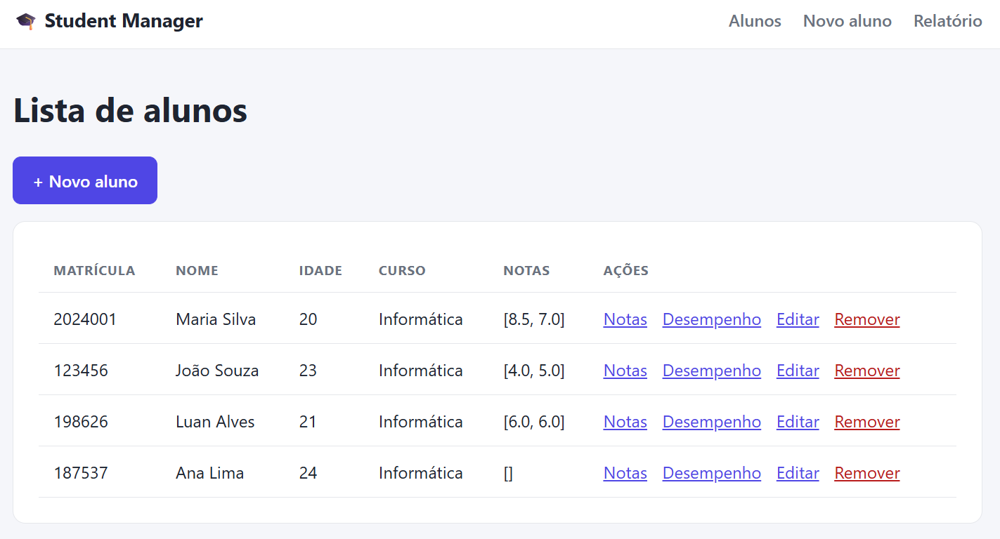
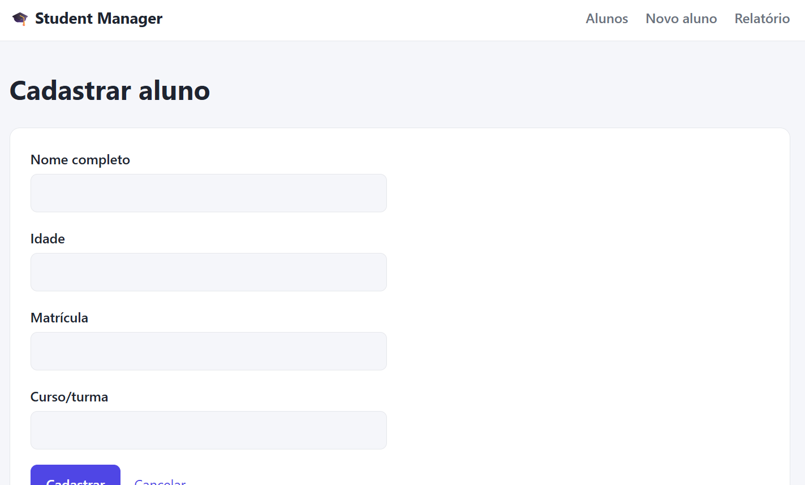
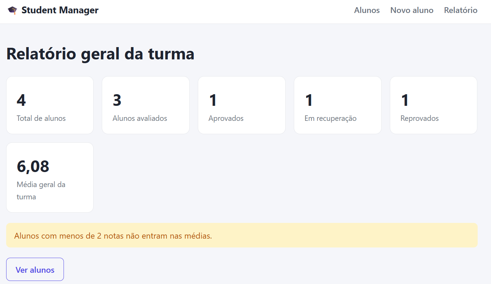
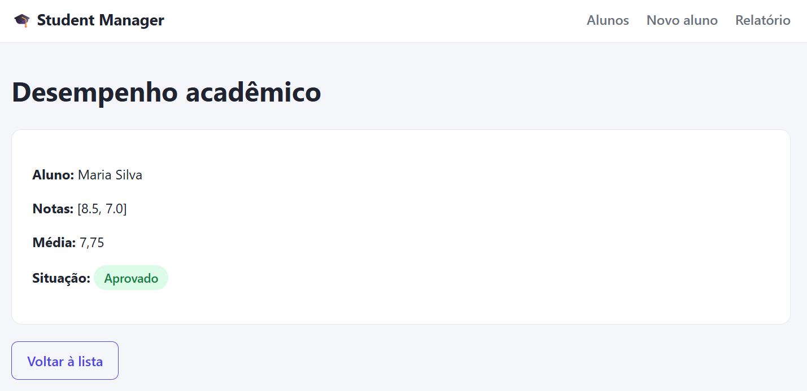

# 🎓 StudentManager Web

Versão web do sistema de gerenciamento escolar **StudentManager**, desenvolvida em **Java 21** com **Spring Boot** e **Thymeleaf**. Permite cadastrar alunos, registrar notas, calcular médias e acompanhar o desempenho acadêmico de uma turma direto no navegador.

> Evolução do [StudentManager](https://github.com/ingridalvesfarias/StudentManager), a versão em Java puro executada no terminal. As regras de negócio (modelo, serviço e cálculo de média) foram reaproveitadas, e a interface do terminal foi substituída por Controllers e páginas HTML.

## 🎯 Objetivo

Praticar o desenvolvimento web com Java: arquitetura em camadas, injeção de dependência, validação de formulários e renderização de páginas no servidor, partindo de um projeto já existente e migrando a interface do terminal para a web.

## ✨ Funcionalidades

- Cadastro de alunos com nome, idade, matrícula única e curso/turma
- Listagem de todos os alunos em tabela
- Registro de notas de 0 a 10 (de 2 a 3 notas por aluno)
- Cálculo automático da média e da situação acadêmica
- Edição de dados do aluno (a matrícula não pode ser alterada)
- Remoção de alunos com tela de confirmação
- Relatório geral da turma
- Validação dos formulários com mensagens de erro nos campos
- Prevenção de matrículas duplicadas
- Interface responsiva com tema claro e escuro (acompanha o sistema)

### Regra de situação acadêmica

| Média | Situação |
|---|---|
| 7,0 ou mais | Aprovado |
| 5,0 a 6,9 | Recuperação |
| Abaixo de 5,0 | Reprovado |

O relatório geral mostra o total de alunos, avaliados, aprovados, em recuperação, reprovados e a média geral da turma. Alunos com menos de 2 notas contam no total, mas não entram nas médias.

## 🛠️ Tecnologias utilizadas

- Java 21
- Spring Boot (Spring Web MVC, Validation e DevTools)
- Thymeleaf (templates e fragments)
- Maven (com Maven Wrapper incluído)
- HTML5 e CSS3 (variáveis CSS, grid, `prefers-color-scheme`)
- Git e GitHub para versionamento

## 🖼️ Telas

| Lista de alunos | Cadastro com validação |
|---|---|
|  |  |

| Relatório geral | Desempenho |
|---|---|
|  |  |

## 🧱 Arquitetura

O fluxo de uma requisição segue o padrão MVC:

```
Navegador → Controller → Service → Model
                ↓
           Template (Thymeleaf) → HTML
```

- **Controller:** recebe a requisição, valida o formulário e escolhe a página.
- **Service:** concentra as regras de negócio e guarda os alunos em memória.
- **Model:** entidade `Aluno`, `record`s de resultado e o `enum` de situação.
- **DTO (formulários):** classes que carregam os dados digitados e declaram as validações.
- **Templates:** páginas Thymeleaf, com cabeçalho e menu compartilhados por fragment.

## 📁 Estrutura de pastas

```
StudentManager-Web/
├── src/main/
│   ├── java/studentmanager/
│   │   ├── StudentmanagerApplication.java
│   │   ├── controller/
│   │   │   ├── HomeController.java
│   │   │   ├── AlunoController.java
│   │   │   └── RelatorioController.java
│   │   ├── dto/
│   │   │   ├── AlunoForm.java
│   │   │   ├── EditarAlunoForm.java
│   │   │   └── NotaForm.java
│   │   ├── model/
│   │   │   ├── Aluno.java
│   │   │   ├── Desempenho.java
│   │   │   ├── RelatorioTurma.java
│   │   │   └── SituacaoAcademica.java
│   │   ├── service/
│   │   │   └── AlunoService.java
│   │   ├── util/
│   │   │   └── CalculadoraMedia.java
│   │   └── exception/
│   │       └── MatriculaDuplicadaException.java
│   └── resources/
│       ├── application.properties
│       ├── static/css/style.css
│       └── templates/
│           ├── home.html
│           ├── relatorio.html
│           ├── fragments/layout.html
│           └── alunos/
│               ├── lista.html
│               ├── form.html
│               ├── editar.html
│               ├── notas.html
│               ├── desempenho.html
│               └── remover.html
├── pom.xml
├── mvnw
├── mvnw.cmd
├── .gitignore
└── README.md
```

## 🔗 Rotas

| Método | Rota | Descrição |
|---|---|---|
| GET | `/` | Página inicial |
| GET | `/alunos` | Lista de alunos |
| GET | `/alunos/novo` | Formulário de cadastro |
| POST | `/alunos` | Cadastra o aluno |
| GET | `/alunos/{matricula}/notas` | Formulário de nota |
| POST | `/alunos/{matricula}/notas` | Registra uma nota |
| GET | `/alunos/{matricula}/desempenho` | Média e situação do aluno |
| GET | `/alunos/{matricula}/editar` | Formulário de edição |
| POST | `/alunos/{matricula}/editar` | Salva as alterações |
| GET | `/alunos/{matricula}/remover` | Tela de confirmação |
| POST | `/alunos/{matricula}/remover` | Remove o aluno |
| GET | `/relatorio` | Relatório geral da turma |

Ações que alteram dados usam **POST**. A remoção passa por uma tela de confirmação para que um simples link nunca apague um aluno.

## ▶️ Como executar

**Pré-requisito:** JDK 21 ou superior (`java -version`). O Maven não precisa estar instalado, pois o projeto inclui o Maven Wrapper.

1. Clone o repositório:

```bash
git clone https://github.com/ingridalvesfarias/StudentManager-Web.git
cd StudentManager-Web
```

2. Execute a aplicação.

No PowerShell (Windows):

```powershell
.\mvnw spring-boot:run
```

No Linux ou macOS:

```bash
./mvnw spring-boot:run
```

3. Abra no navegador: **http://localhost:8080**

> Os dados ficam guardados em memória: ao parar o servidor, os alunos cadastrados são perdidos.

## 🧠 Conceitos aplicados

- Arquitetura em camadas (Controller, Service e Model) e padrão MVC
- Injeção de dependência com `@Service` e injeção por construtor
- Validação de formulários com Bean Validation (`@Valid`, `@NotBlank`, `@Min`, `@Max`) e `BindingResult`
- Padrão Post-Redirect-Get com mensagens `flash` para evitar reenvio de formulário
- Rotas com parâmetro (`@PathVariable`) e uso correto de GET e POST
- Templates Thymeleaf: `th:each`, `th:if`, `th:field`, `th:errors` e fragments reutilizáveis
- Exceção personalizada tratada e convertida em erro no campo do formulário
- `enum` e `record` do Java moderno
- CSS com variáveis, grid responsivo e tema escuro automático

## 🚀 Próximos passos

- Persistência dos dados em banco (Spring Data JPA com H2 ou PostgreSQL)
- Pesquisa de alunos por nome ou matrícula (já existente na versão de terminal)
- Testes unitários com JUnit e testes de Controller com MockMvc
- Publicação da aplicação online

## 👩‍💻 Autora

**Ingrid Farias** — [GitHub](https://github.com/ingridalvesfarias)